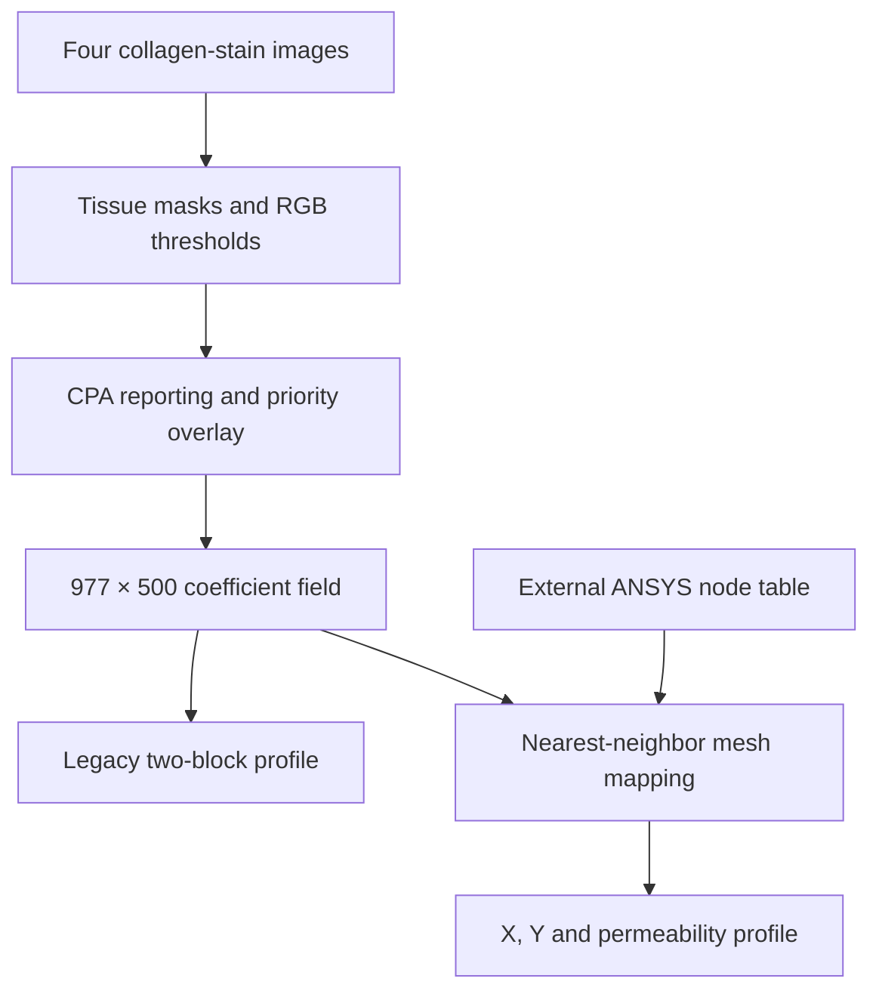

# Liver image analysis and mesh profiles

**Turning stained liver tissue images into inputs for computer simulations.**

Selected code from my contribution to a collaborative liver digital-twin research project at the **Long Island University Bioengineering Lab**, during my May to August 2025 research internship.

I developed image-processing and mesh-mapping code while working with the lab and a machine-learning postdoctoral researcher. This extract shows how collagen-stain images become a spatial coefficient field that can be exported for an ANSYS simulation workflow. The wider research project, experimental data, and scientific interpretation are collaborative work.

## What the code does

The pipeline reads four images for collagen types I, III, IV, and VI. It estimates a tissue mask, applies stain-specific RGB thresholds, and reports collagen proportionate area (CPA) as a percentage of tissue pixels.

Masks are combined with a fixed priority: COL-I takes precedence over COL-III; COL-IV and COL-VI retain the historical black/background representation. The composite is resized to a 977 × 500 grid, then exact red and green pixel matches determine the stored permeability values.

A second workflow scales an ANSYS mesh's X/Y bounds onto that grid, reverses the X orientation to match the historical image convention, and uses a SciPy KDTree to assign each mesh node its nearest image value.



## Code and example output

| Path | Purpose |
| --- | --- |
| [src/collagen_prof.py](src/collagen_prof.py) | Image masks, CPA, overlay, grid and legacy profile writer |
| [src/mesh_profile.py](src/mesh_profile.py) | ANSYS node parser, coordinate normalization, KDTree mapping and profile validation |
| [src/inspect_prof.py](src/inspect_prof.py) | Inspector for the legacy two-block format |
| [tests/test_profile_format.py](tests/test_profile_format.py) | Existing, self-contained grid and writer-layout checks |
| [deliverables/](deliverables/) | Existing generated Phase 4 mesh profile and verified numeric summary |
| [docs/INPUTS_AND_FORMATS.md](docs/INPUTS_AND_FORMATS.md) | Input contract and preserved format details |

The example profile has **8,427 nodes**. It is an existing generated artifact; its [documentation](deliverables/README.md) records the file checksum and value counts. It demonstrates the export format, without establishing simulation accuracy.

## Install and run

Use Python 3.10 or later. Run these commands from this project directory:

```bash
python3 -m venv .venv
source .venv/bin/activate
python -m pip install -r requirements.txt

python src/collagen_prof.py 4 --input-dir /path/to/stains --output-dir outputs
python src/inspect_prof.py outputs/my_permeability_profile_phase4.prof

python src/mesh_profile.py 4 /path/to/F4.txt outputs/phase4_mesh.prof \
  --stain-dir /path/to/stains
```

Supply four PNGs named `phase4_COL-IB.png`, `phase4_COL-IIIB.png`, `phase4_COL-IVB.png`, and `phase4_COL-VIB.png`. Other phase numbers from 0 through 4 use the same naming pattern. The mesh workflow also needs a tab-separated ANSYS node export; its required header and summary row are documented [here](docs/INPUTS_AND_FORMATS.md).

## Preserved behavior and reproducibility

The current scripts use fixed thresholds, including Phase 4 overrides. Threshold optimization is not performed during a run. Coefficients are retained exactly: `2.5e14` for COL-I, `1.0e14` for COL-III, and `6.0e13` for background. Their physical interpretation requires the original simulation setup.

The legacy writer intentionally places permeability values in its `(y ...)` block. The mesh writer instead has separate `(x ...)`, `(y ...)`, and `(permeability ...)` blocks. Use the correct importer for each.

Images and the source mesh are supplied separately. Resizing, strict color comparisons, mask priority, and bounding-box normalization all affect results; the scripts do not register tissue sections or validate a biological model. Dependency ranges are preserved, rather than a fully pinned environment.

For the included format tests:

```bash
python -m pip install -r requirements-dev.txt
python -m pytest -q
```

This extract passed Python syntax checks and a structural/checksum inspection of the example profile. Runtime tests and dataset regeneration were not run in the preparation environment, which lacked OpenCV and pytest. ANSYS import compatibility remains dependent on the target model and software version.

[GitHub profile](https://github.com/ilaygibor)
